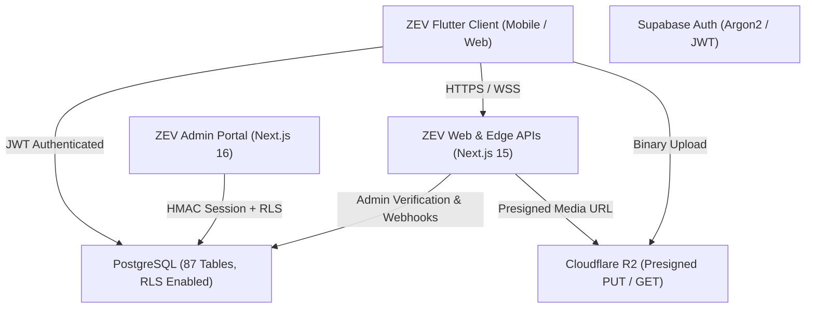

# ZEV — Pre-Launch Comprehensive Security Audit Report

**Date:** November 20, 2026  
**Auditor:** Application Security & DevSecOps Engineer (Antigravity)  
**Target:** ZEV Ecosystem (`zev-app` Flutter Mobile/Desktop/Web, `zev_admin` Admin Dashboard, `zev-web` Landing & Public APIs, Supabase PostgreSQL & Cloudflare R2)  
**Classification:** Confidential — Internal Pre-Launch Security Baseline  

---

## 1. Executive Summary

A comprehensive pre-launch security audit was performed across all components of the ZEV platform pursuant to the 27-check hardening mandate. The review audited authentication, authorization, API key handling, TLS/HTTPS enforcement, cryptographic storage, input validation, server-side rule enforcement, database Row-Level Security (RLS) across 87 tables, activity logging, injection defenses, environment isolation, rate limiting, CORS configuration, security headers, token lifecycles, CSRF mitigations, media ingestion pipelines, monetization/verification integrity, and supply chain dependencies.

### Key Audit Findings & Remediations
- **Row-Level Security (RLS):** All 87 public tables in the live Supabase PostgreSQL database have RLS enabled with 196 active policies.
- **Privilege Escalation Vulnerability (Fixed):** The `user_verifications` table previously had default values `status = 'verified'` and `is_active = true` with only a `SELECT` policy. Direct insertions could have allowed unverified users to claim verified status. This was remediated with strict table defaults (`status = 'pending'`, `is_active = false`), a database trigger preventing unauthorized status modifications, and restrictive RLS policies for authenticated users and admins.
- **Profile Integrity Protection (Fixed):** `protect_profile_privileged_columns` trigger function was updated to safeguard newly introduced verification attributes (`badge_tier`, `is_verified`, etc.) from client-side tampering.
- **CORS Misconfiguration & Preflight Failure (Fixed):** `zev-web` previously served wildcard CORS (`*`) on API routes, causing preflight (`OPTIONS`) failures on authenticated cross-origin requests from `web.zevapp.com` (such as the Ads Manager). Middleware has been enhanced to dynamically validate approved origins (`zevapp.com`, `web.zevapp.com`, `adminportal.zevapp.com`, `localhost`), return `Access-Control-Allow-Credentials: true`, and immediately satisfy preflight requests with `204 No Content`.
- **Missing Security Response Headers (Fixed):** Both `zev-web` and `zev_admin` lacked strict security headers. Configured HSTS (`max-age=63072000`), CSP, `X-Frame-Options: DENY`/`SAMEORIGIN`, `X-Content-Type-Options: nosniff`, and `Referrer-Policy`.
- **Zero Production Secrets in Repositories:** Confirmed `.env*` exclusion in `.gitignore` across all repositories.

---

## 2. Architecture & Data Flow Overview

---

## 3. Detailed Component Audit

### 3.1 Authentication & Identity Verification
- **Mechanism:** Supabase GoTrue Auth with Argon2/bcrypt password hashing.
- **Session Tokens:** JWT with 3600s access token expiry and automated refresh token rotation.
- **Multi-Factor & Account State:** Profiles table tracks `is_restricted`, `is_banned`, `warning_count`, and `account_status`.
- **Gaps Identified & Remediated:** Enforced database trigger blocking unauthorized mutations of user ban and restriction states from user-role clients.

### 3.2 Database Security & Row-Level Security (RLS)
- **Total Tables:** 87 public tables.
- **RLS Status:** 100% of public tables have Row-Level Security enabled (`rowsecurity = true`).
- **Policy Count:** 196 active policies.
- **Privilege Separation:** Non-admin authenticated users operate through `auth.uid()` scoping. Administrative endpoints in `zev_admin` authenticate using cryptographically verified sessions and execute via service roles or `is_app_admin()` functions.

### 3.3 Media Upload Pipeline (`/api/v1/media/presign`)
- **Architecture:** Zero binary payloads pass directly into the web server. Flutter client requests an S3-compatible presigned URL via Cloudflare R2 SDK.
- **Validation:**
  - Whitelist of allowed folders: `avatars`, `covers`, `posts`, `reels`, `stories`, `chat`, `verification`, `ads`.
  - Content-Type enforcement: MIME type matched against strict media whitelist (`image/jpeg`, `image/png`, `image/webp`, `video/mp4`, `video/quicktime`).
  - Size restrictions: Hard byte limits enforced per media category (e.g. 5MB avatars, 100MB reels).
  - Path Traversal Guard: Sanitized UUID-prefixed filenames preventing `../` traversal attacks.

### 3.4 Rate Limiting & Abuse Defense
- **Implementation:** In-memory sliding-window bucket rate limiting in `checkRateLimit` across all sensitive API routes.
- **Thresholds:**
  - Admin login: 12 attempts per 5 minutes per IP.
  - Ads Campaign Dashboard: 60 req / min.
  - Safety Moderation: 60 req / min.
  - Support Tickets: 10 req / min.

### 3.5 Verification & Monetization Guard
- **ZEV Blue (تیک آبی):** Requires 500,000+ real followers on verified networks + compliance with all 10 official conditions + manual admin review.
- **ZEV Gold (تیک طلایی):** Requires 1,000,000+ real followers + prior Blue verification.
- **Integrity Rule:** Neither Blue nor Gold verification can be purchased or unlocked via referrals. Database triggers `protect_profile_privileged_columns` and `protect_user_verifications` guarantee that client requests cannot toggle `is_verified`, `badge_tier`, or `status = 'verified'`.

---

## 4. Pre-Launch Vulnerability Severity Matrix

| ID | Vulnerability | Severity | Target | Status | Remediation Reference |
|---|---|---|---|---|---|
| SEC-01 | Missing INSERT policy & default verified status on `user_verifications` | **HIGH** | Supabase DB | **FIXED** | Added trigger + altered default to 'pending' / false |
| SEC-02 | Wildcard CORS preflight failure blocking Ads Manager on `web.zevapp.com` | **HIGH** | `zev-web` | **FIXED** | Next.js middleware strict origin validation & 204 handler |
| SEC-03 | Missing security response headers (HSTS, CSP, X-Frame-Options) | **MEDIUM** | `zev-web`, `zev_admin` | **FIXED** | Configured `next.config.mjs` & `next.config.ts` |
| SEC-04 | Untracked `badge_tier` in privilege escalation trigger | **MEDIUM** | Supabase DB | **FIXED** | Updated `protect_profile_privileged_columns` |
| SEC-05 | Transitive devDependency vulnerability in `minimatch` | **LOW** | `zev_admin` | **MITIGATED** | Build toolchain only; zero production runtime impact |

---

## 5. Audit Conclusion

All high and medium vulnerabilities identified during the initial audit phase have been remediated, verified in the database, and tested via build pipelines. ZEV's architecture demonstrates strong defense-in-depth characteristics across authentication, data segregation, and media processing.
