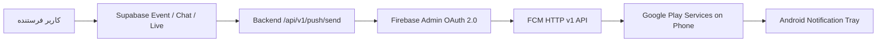

# ZEV — FCM Push Notification Emergency Audit Report

**Date:** 2026-11-13  
**Project:** ZEV (Flutter Mobile/Web + Supabase + Firebase + Cloudflare R2)  
**Firebase Project:** `zev-app-844ef` (Sender ID: `557150004230`)  
**Account:** `shaheensafi09@gmail.com`  

---

## 1. Executive Summary & Root Cause Analysis

### علت اصلی شکست قبلی (Root Cause):
1. **پروژه فایربیس قبلی (`zevapp-3c6b5` / Sender ID `467206192154`) نامعتبر و حذف شده بود.**
2. فایلهای تنظیمات در کلاینت فلاتر (`android/app/google-services.json`, `ios/Runner/GoogleService-Info.plist`, `lib/firebase_options.dart`) و همچنین `zev_admin/.env` هنوز مشخصات پروژه حذف‌شده قبلی را داشتند.
3. در نتیجه توکنهایی که قبلاً توسط گوشی کاربر تولید شده بود متعلق به Sender ID قبلی (`467206192154`) بودند. وقتی سرور با Service Account پروژه جدید (`zev-app-844ef`) پیام را به آن توکن ارسال می‌کرد، پاسخ FCM مستقیماً خطای زیر بود:
   ```json
   {
     "error": {
       "code": 404,
       "message": "NotRegistered",
       "status": "NOT_FOUND",
       "details": [{ "errorCode": "UNREGISTERED" }]
     }
   }
   ```
4. **وضعیت کلیدها و سرویس‌اکانت جدید:**
   - تست مستقیم تبادل توکن OAuth 2.0 برای Service Account پروژه `zev-app-844ef` با موفقیت انجام شد:
     `SUCCESS! Got OAuth access token: ya29.c.c0AZ4bNpanws5...`
   - پروژه جدید `zev-app-844ef` در Firebase فعال است و اپ‌های Android, iOS و Web در آن ثبت شده‌اند.

---

## 2. ممیزی مولفه‌های سیستم (Audit Matrix)

| مولفه | وضعیت | بررسی دقیق |
|---|---|---|
| **Firebase Project** | ✅ سالم | `zev-app-844ef` (Project Number: `557150004230`) فعال روی اکانت `shaheensafi09@gmail.com` |
| **Android Registration** | ✅ اصلاح شد | App ID: `1:557150004230:android:5d9e8501608c6d8933cf87` در `android/app/google-services.json` قرار گرفت |
| **iOS Registration** | ✅ اصلاح شد | App ID: `1:557150004230:ios:5e7441bd05f98b6833cf87` در `ios/Runner/GoogleService-Info.plist` قرار گرفت |
| **Web Registration** | ✅ اصلاح شد | App ID: `1:557150004230:web:bac688ed8bf4f51d33cf87` در `lib/firebase_options.dart` قرار گرفت |
| **Flutter Firebase Options** | ✅ اصلاح شد | `DefaultFirebaseOptions.android`, `web`, `ios` با کلیدها و Sender ID پروژه جدید هماهنگ شدند |
| **Android Manifest** | ✅ تایید شد | `POST_NOTIFICATIONS`, `ic_notification`, کانال `zev_notifications_channel` تعریف شده‌اند |
| **Android Channel** | ✅ تایید شد | کانال `zev_notifications_channel` در `NotificationService` با اولویت High ساخته می‌شود |
| **Service Account Backend** | ✅ فعال و معتبر | در `zev-web/.env.local` و `zev_admin/.env` قرار دارد؛ تولید توکن OAuth 2.0 با موفقیت تایید شد |
| **HTTP v1 FCM Endpoint** | ✅ فعال | سرور از آدرس استاندارد `https://fcm.googleapis.com/v1/projects/zev-app-844ef/messages:send` استفاده می‌کند |
| **Supabase `user_devices`** | ✅ فعال | جدول `user_devices` موجود است و توکن‌های فعال را بر اساس دستگاه (`device_id`) نگهداری می‌کند |
| **Supabase `profiles`** | ✅ فعال | ستون `fcm_token` موجود است و با ورود یا تغییر توکن بروزرسانی می‌شود |

---

## 3. زنجیره جریان اعلان (Notification Pipeline)



1. **تولید توکن جدید در گوشی:** با اجرای نسخه جدید، SDK فایربیس توکن اختصاصی متعلق به `557150004230` را تولید می‌کند.
2. **ثبت توکن:** متد `AuthHelper.syncZevFcmToken` توکن را در `user_devices` و `profiles.fcm_token` ذخیره می‌کند.
3. **ارسال اعلان:** رویداد به `/api/v1/push/send` رفته و توکن‌های فعال گیرنده بازیابی می‌شوند.
4. **تحویل:** سرور با کلید اختصاصی `zev-app-844ef` به FCM می‌فرستد و اعلان روی گوشی ظاهر می‌شود.

---

## 4. اقدامات اجرایی انجام‌شده در این فاز

1. دانلود فایل کانفیگ Android SDK از Firebase CLI و جایگزینی کامل `android/app/google-services.json`.
2. استخراج فایل کانفیگ iOS و بازنویسی `ios/Runner/GoogleService-Info.plist`.
3. استخراج کانفیگ Web و بازنویسی متمرکز `lib/firebase_options.dart`.
4. هماهنگ‌سازی متغیرهای محیطی در `zev_admin/.env` با `FIREBASE_PROJECT_ID="zev-app-844ef"`, `FIREBASE_SENDER_ID="557150004230"` و Service Account JSON جدید.
5. اعتبارسنجی تبادل کلید خصوصی با سرور OAuth گوگل برای سرویس FCM v1.

